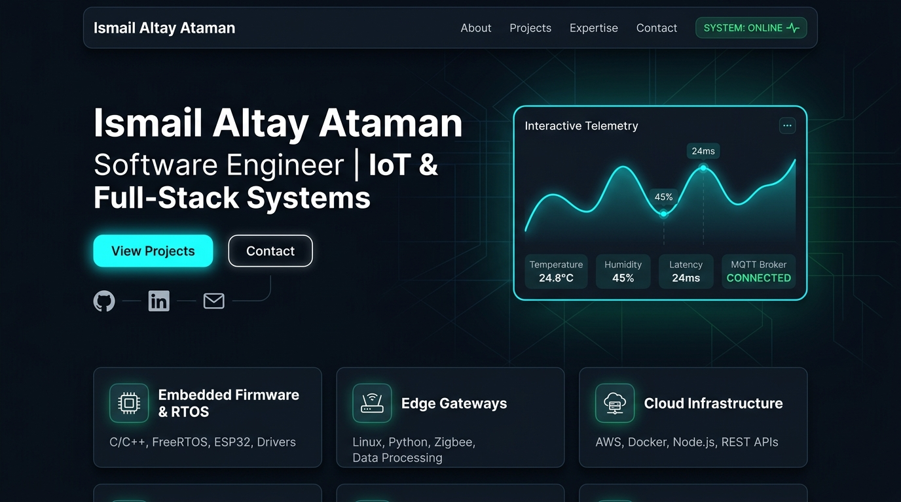
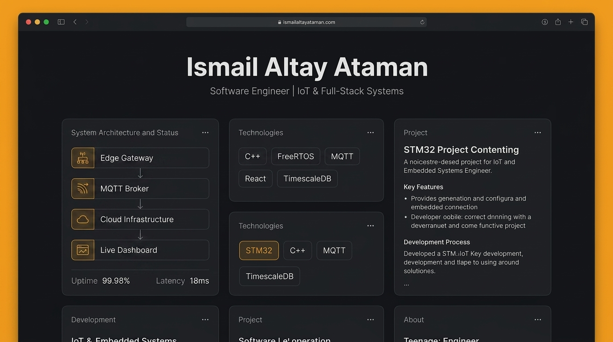

# Portfolio Design Concepts: Ismail Altay Ataman
### Software Engineer | IoT & Full-Stack Systems

Here are the two visual concepts created for your portfolio review:

---

## Concept 1: Precision Telemetry & Cyber-Industrial

### Key Highlights:
- **Atmosphere:** Deep slate/onyx (`#0B0F17`) with subtle circuit grid lines and electric cyan / emerald glowing accents.
- **Hero Telemetry Widget:** Real-time simulated waveform graph displaying latency (`24ms`), temperature (`24.8°C`), humidity (`45%`), and connection status (`MQTT Broker: CONNECTED`).
- **Live Status Header:** Real-time `SYSTEM: ONLINE ∿` pulse indicator in the top navbar.
- **Bento Overview:** Quick architectural pillars (Embedded Firmware & RTOS, Edge Gateways, Cloud Infrastructure).

---

## Concept 2: Industrial Minimalist (Updated - No MCU Graphic)

### Key Highlights:
- **Atmosphere:** Dark matte graphite (`#121316`) with titanium white typography and subtle warm amber/gold status highlights.
- **System Architecture & Status Card:** Clean, architectural pipeline diagram showing **Edge Gateway → MQTT Broker → Cloud Infrastructure → Live Dashboard**, with live metrics (`Uptime: 99.98%`, `Latency: 18ms`).
- **Clean Bento Structure:** High-precision cards highlighting technologies (`C++`, `FreeRTOS`, `MQTT`, `React`, `TimescaleDB`, `STM32`).
- **Feel:** Understated, engineering-focused, modern software studio aesthetic without intrusive hardware illustrations.

---

## Comparison Summary

| Feature | Concept 1: Precision Telemetry | Concept 2: Industrial Minimalist |
| :--- | :--- | :--- |
| **Theme** | High-tech, Cyber-Industrial | Clean, Minimalist Architectural |
| **Accent Colors** | Electric Cyan & Emerald Green | Warm Amber & Titanium Silver |
| **Hero Focus** | Live Interactive Telemetry Card | Hardware Pinout & Spec Sheet Card |
| **Recommended For** | Emphasizing real-time IoT & live cloud telemetry | Emphasizing low-level firmware & hardware craftsmanship |

> [!TIP]
> We can also create a **Hybrid** that blends the clean modular layout of Concept 2 with the live interactive telemetry graph of Concept 1!
